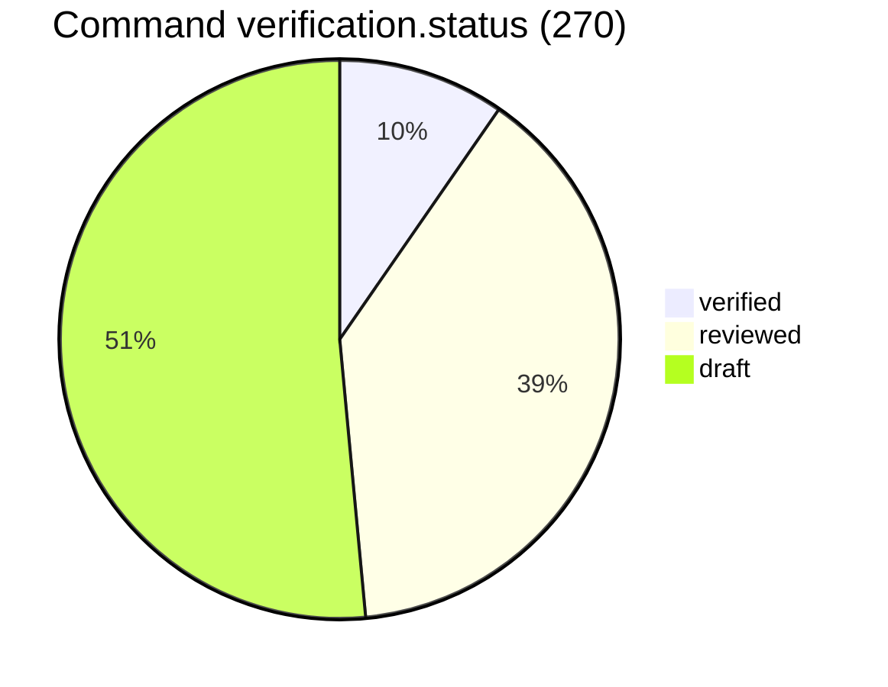
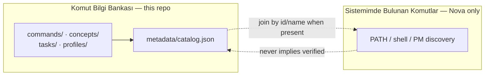
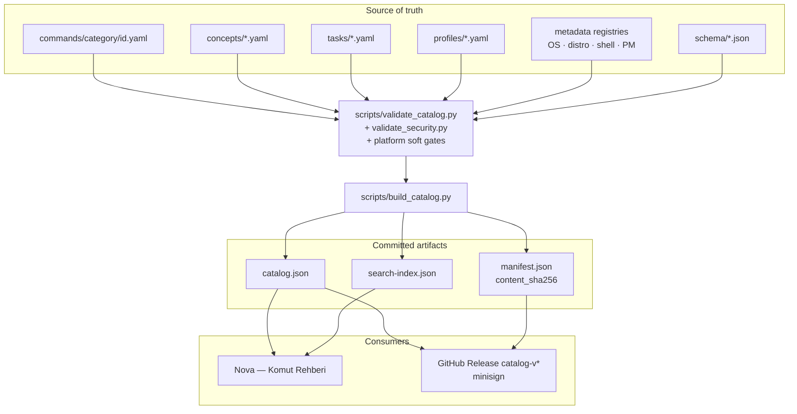
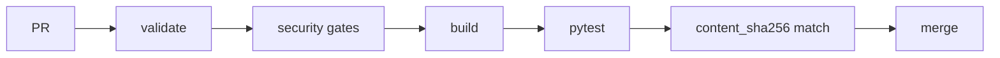
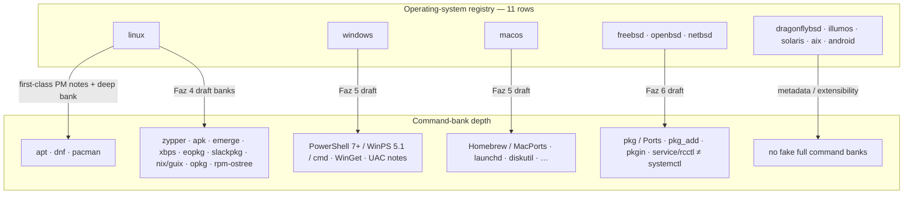
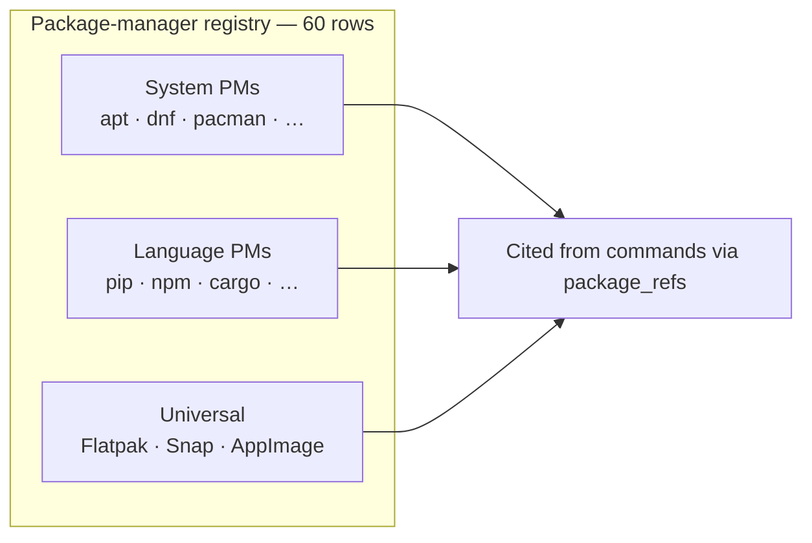
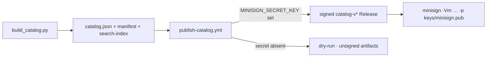
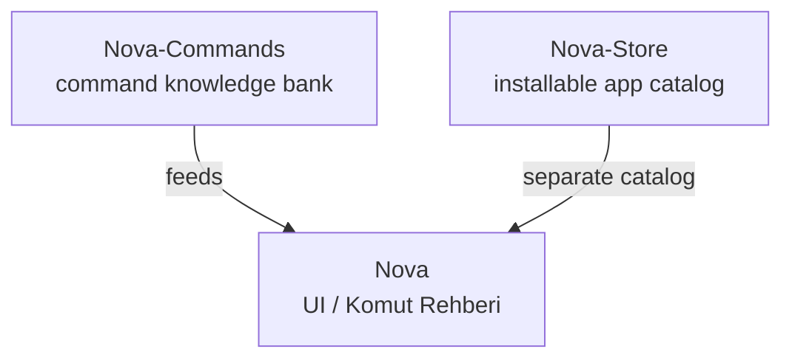

# Nova-Commands

Open-source **cross-platform command & system-administration knowledge base** —
searchable, categorized, bilingual (TR/EN), schema-validated YAML.

Feeds Nova’s **Komut Rehberi**; usable standalone. Data format is
application-independent.

**Repository:** https://github.com/Teknoloji-Filozoflari/Nova-Commands  
**Türkçe:** [README.tr.md](README.tr.md)

```
YAML bank  →  validate + build  →  catalog / search / manifest  →  Nova UI · signed Releases
```

---

## Contents

1. [Live catalog](#live-catalog-after-23)
2. [Dual concept](#dual-concept)
3. [Architecture](#architecture)
4. [Repository map](#repository-map)
5. [Platform & package managers](#platform--package-managers)
6. [Developer](#developer)
7. [Signed catalog Releases](#signed-catalog-releases)
8. [Security](#security)
9. [Contributing](#contributing)
10. [Related projects](#related-projects)

---

## Live catalog (after [#30](https://github.com/Teknoloji-Filozoflari/Nova-Commands/pull/30))

Counts from committed `metadata/manifest.json` / `search-index.json` — not marketing
targets. Trust-audit follow-up may bump the digest when warnings/status honesty land.

| Metric | Value |
|--------|------:|
| Commands | **270** |
| Concepts | **30** |
| Tasks / profiles | **36** / **14** (all `draft`) |
| Search entries | **350** |
| OS / package-manager registry rows | **11** / **60** |
| `schema_version` | **2** |
| verification (commands) | verified **26** / reviewed **105** / draft **139** |
| verification (concepts) | reviewed **1** / draft **28** (no fake `verified`) |
| `content_sha256` | `e6466b7f777fe49019c2cc7d6d4bcf279857d76a209e7ca68b7292f5f945ec06` |



Registry presence ≠ every command verified on that OS. Roadmap:
[docs/ROADMAP.md](docs/ROADMAP.md).

---

## Dual concept

Keep these **strictly separate** — UI and docs must not blur them.

| Concept | Meaning | This repo? |
|---------|---------|------------|
| **Komut Bilgi Bankası** | Curated / schema’d / verification-stated knowledge | Yes — `commands/`, `concepts/`, `tasks/`, `profiles/` |
| **Sistemimde Bulunan Komutlar** | Host PATH / package discovery (Nova local) | No — [contract only](docs/local-discovery-contract.md) |



Details: [docs/dual-concept.md](docs/dual-concept.md)

---

## Architecture

Data repo first: YAML + JSON Schema + CI. No runtime daemon here.





- `verification.status` is **never** auto-promoted to `verified` by CI.
- `content_sha256` hashes commands + concepts + tasks + profiles (excludes `generated_at`).
- Deeper layout: [docs/architecture.md](docs/architecture.md)

---

## Repository map

```
commands/<category>/<id>.yaml     # source of truth (schema_version: 2)
concepts/<id>.yaml                # learnable articles (TR/EN)
tasks/<id>.yaml                   # intent → multi-OS implementations
profiles/<id>.yaml                # server / role reference collections

schema/command.schema.json        # v2 — live commands/ bank
schema/command.schema.v2.json     # v2 twin (tooling $id)
schema/command.schema.v1.json     # archived v1
schema/{task,profile,concept,…}.schema.json

metadata/categories.yaml          # §8.x taxonomy (21 categories)
metadata/operating-systems.yaml   # OS ≠ distro ≠ shell ≠ PM
metadata/{distributions,shells,package-managers,…}.yaml
metadata/catalog.json             # aggregate bank (schema_version 2)
metadata/search-index.json
metadata/manifest.json            # counts + deterministic content_sha256

scripts/validate_catalog.py       # CI gate
scripts/validate_security.py      # static safety hard gates
scripts/build_catalog.py          # catalog / index / manifest
scripts/migrate_v1_to_v2.py       # idempotent v1→v2

docs/PLATFORM_SUPPORT.md          # platform matrix
docs/ROADMAP.md                   # Faz 0–11 status
docs/SECURITY_MODEL.md            # risk / trust
docs/SCHEMA_MIGRATION_V2.md       # migration + release policy
docs/NOVA_INTEGRATION.md          # Nova consume contract
```

Command categories in the live bank:

`filesystem` · `text` · `search` · `processes` · `system` · `network` · `users` ·
`packages` · `archives` · `disks` · `shell` · `development` · `containers` ·
`security` · `monitoring` · `hardware` · `virtualization` · `backup` ·
`databases` · `cloud` · `devops`

---

## Platform & package managers

Honest scope — registry rows and draft banks are **not** full verification
coverage. Prefer Arch / **pacman** in Arch-family install notes.





| Area | What’s in tree | Honesty note |
|------|----------------|--------------|
| Linux PMs | apt / dnf / pacman first-class; broader PMs as `draft` | Most non-first-class rows are `draft` / `partial` |
| Windows / macOS | Draft command banks + shell/PM registry rows | Not claimed `verified` en masse |
| BSD | FreeBSD / OpenBSD / NetBSD draft banks | DragonFly / illumos / Solaris / AIX mostly skeleton |
| Server / DevOps | Network, K8s clients, libvirt, backup, cloud CLI, IaC (`draft`) | Categories exist; depth varies |
| Tasks / profiles | 26 + 13, all `draft` | Guiding recipes — **not** auto-executed |

Compare: [docs/package-managers-comparison.md](docs/package-managers-comparison.md) ·
Platform: [docs/PLATFORM_SUPPORT.md](docs/PLATFORM_SUPPORT.md) ·
Server: [docs/SERVER_ADMINISTRATION.md](docs/SERVER_ADMINISTRATION.md) ·
Roadmap: [docs/ROADMAP.md](docs/ROADMAP.md)

---

## Developer

Use a **project virtualenv** — do not install into system `/usr/bin/python3`.
Deps live in [`requirements-dev.txt`](requirements-dev.txt) (`jsonschema`,
`referencing`, `PyYAML`, `pytest`). CI installs the same file.

```bash
python3 -m venv .venv
source .venv/bin/activate          # Windows: .venv\Scripts\activate
python -m pip install -r requirements-dev.txt

python scripts/validate_catalog.py # schema v1+v2, examples, tasks, profiles,
                                   # platform registries, generated catalog
python scripts/build_catalog.py    # catalog.json / search-index.json / manifest.json
python -m pytest tests/            # launches validators via sys.executable
```

After a no-op rebuild, `content_sha256` stays stable and `generated_at` is
preserved so the working tree stays clean. Missing required schema fields fail
closed — validators never invent values.

New command / concept: [CONTRIBUTING.md](CONTRIBUTING.md) ·
Nova wire-up: [docs/NOVA_INTEGRATION.md](docs/NOVA_INTEGRATION.md)

---

## Signed catalog Releases

Bank metadata (`catalog.json` / `manifest.json` / `search-index.json`) ships on
GitHub Release tags `catalog-v*`, signed with **minisign**.



- Public key: [`keys/minisign.pub`](keys/minisign.pub)
- Verify + publish: [docs/catalog-signing.md](docs/catalog-signing.md) · [SECURITY.md](SECURITY.md)
- Private key is **never** generated or committed in CI

```bash
minisign -Vm catalog.json -p keys/minisign.pub -x catalog.json.minisig
```

This signs the **command knowledge bank**, not local PATH discovery or the
Nova-Store app catalog ([docs/dual-concept.md](docs/dual-concept.md)).

---

## Security

- AI drafts stay `verification.status: draft`; `verified` only after human review.
- Unknown flags / package names are **not invented**; omit or keep draft.
- Dangerous commands are **not executed** to validate YAML; CI runners never
  execute catalog examples.
- Policy: [SECURITY.md](SECURITY.md) · [docs/SECURITY_MODEL.md](docs/SECURITY_MODEL.md) ·
  [docs/safety.md](docs/safety.md)

---

## Contributing

- [CONTRIBUTING.md](CONTRIBUTING.md) · [docs/ROADMAP.md](docs/ROADMAP.md)
- Issue forms: bug · new command · category · translation (`.github/ISSUE_TEMPLATE/`)
- PR template: `.github/PULL_REQUEST_TEMPLATE.md`
- CI: validate → security gates → build → pytest → committed `content_sha256`
  (Ubuntu / Windows / macOS matrix for **Python tooling only**)

---

## Related projects



- [Nova](https://github.com/Teknoloji-Filozoflari/Nova) — UI / Komut Rehberi
- [Nova-Store](https://github.com/Teknoloji-Filozoflari/Nova-Store) — installable application catalog
- **Nova-Commands** — command knowledge (this repo)

---

## License

MIT — [LICENSE](LICENSE)
