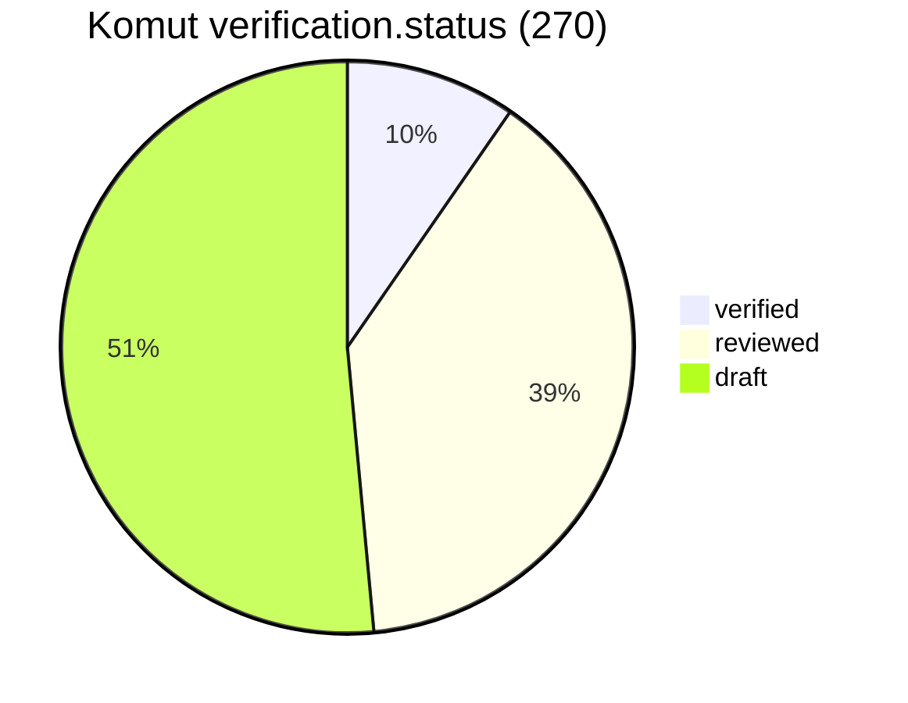
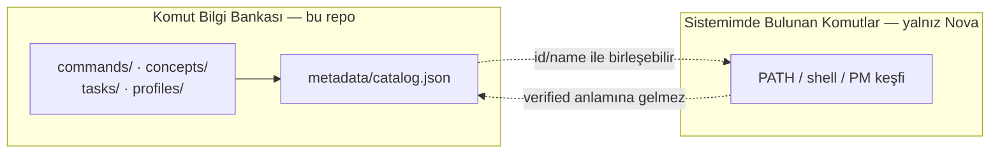
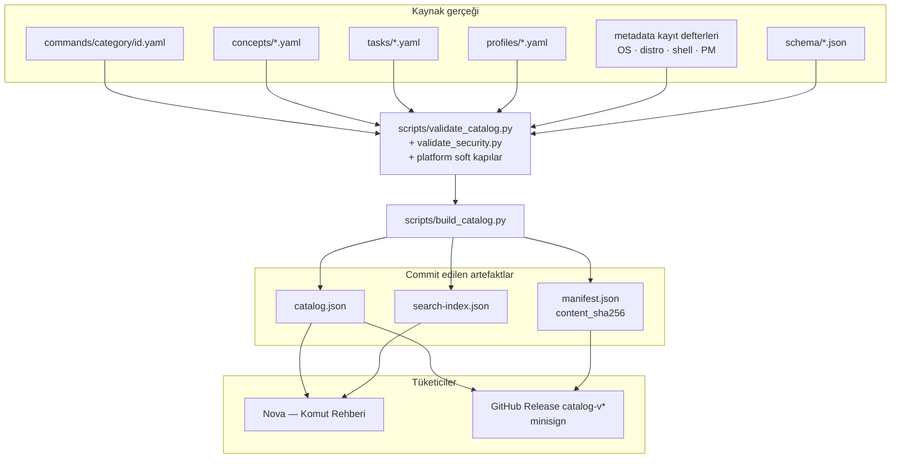
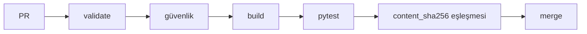
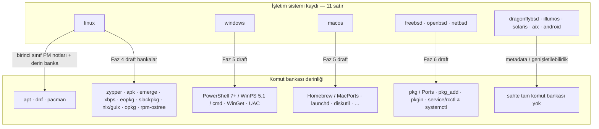
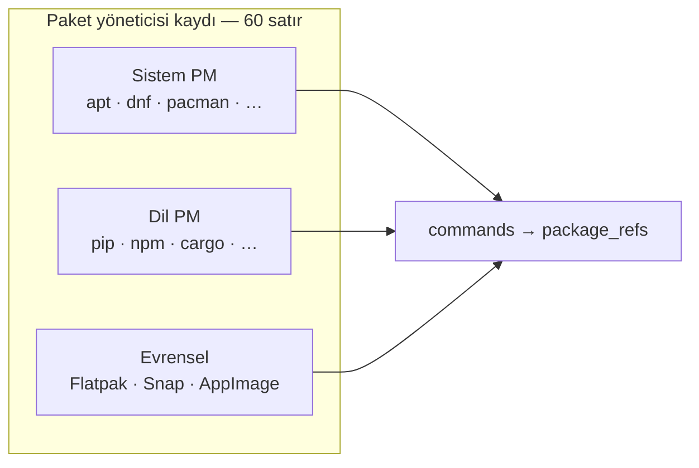
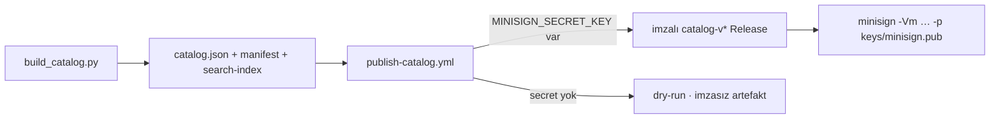
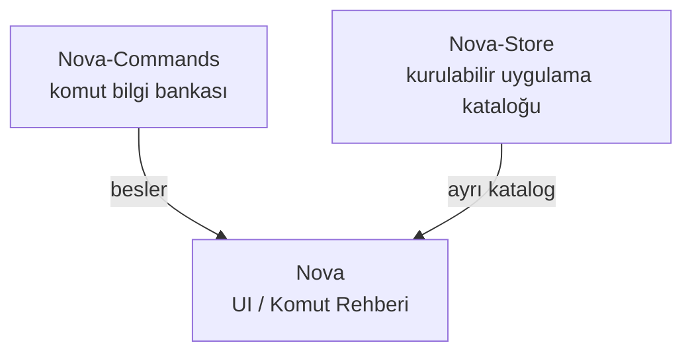

# Nova-Commands

Linux’tan Windows / macOS / BSD ve sunucu–DevOps araçlarına uzanan **açık kaynak komut ve sistem yönetimi bilgi bankası** — aranabilir, kategorize, çok dilli (TR/EN), doğrulanabilir YAML kataloğu.

Nova’nın **Komut Rehberi**ni besler; tek başına da kullanılabilir. Veri formatı uygulamadan bağımsızdır.

**Repository:** https://github.com/Teknoloji-Filozoflari/Nova-Commands  
**English:** [README.md](README.md)

```
YAML bankası  →  doğrula + derle  →  katalog / arama / manifest  →  Nova UI · imzalı Releases
```

---

## İçindekiler

1. [Canlı katalog](#canlı-katalog-post23)
2. [İki alan](#iki-alan--karıştırma)
3. [Mimari](#mimari)
4. [Depo haritası](#depo-haritası)
5. [Platform ve paket yöneticileri](#platform-ve-paket-yöneticileri)
6. [Geliştirici](#geliştirici)
7. [İmzalı katalog Releases](#imzalı-katalog-releases)
8. [Güvenlik](#güvenlik)
9. [Katkı](#katkı)
10. [İlişkiler](#ilişkiler)

---

## Canlı katalog (post–[#30](https://github.com/Teknoloji-Filozoflari/Nova-Commands/pull/30))

Sayılar üretilmiş `metadata/manifest.json` / `search-index.json` ile uyumludur —
pazarlama hedefi değildir. Güven denetimi sonrası özette uyarı/`status`
dürüstlüğü digest’i güncelleyebilir.

| Metrik | Değer |
|--------|------:|
| Komut | **270** |
| Konsept makalesi | **30** |
| Görev (`tasks/`) | **36** (hepsi `draft`) |
| Profil (`profiles/`) | **14** (hepsi `draft`) |
| Arama girdisi | **350** |
| OS kaydı | **11** |
| Paket yöneticisi kaydı | **60** |
| `schema_version` | **2** |
| `verification` (komut) | verified **26** / reviewed **105** / draft **139** |
| `verification` (konsept) | reviewed **1** / draft **28** (sahte `verified` yok) |
| `content_sha256` | `e6466b7f777fe49019c2cc7d6d4bcf279857d76a209e7ca68b7292f5f945ec06` |



Kayıt defterinde bir OS/PM id’si olması, o platformda her komutun doğrulandığı
anlamına **gelmez**. Yol haritası: [docs/ROADMAP.md](docs/ROADMAP.md).

---

## İki alan — karıştırma

Bunları **kesin ayır** — UI ve dokümanlar karıştırmamalı.

| Alan | Ne | Bu repo? |
|------|----|----------|
| **Komut Bilgi Bankası** | Kürate / şemalı / doğrulama durumlu bilgi | Evet — `commands/`, `concepts/`, `tasks/`, `profiles/` |
| **Sistemimde Bulunan Komutlar** | Cihaz PATH / paket keşfi (Nova yerel) | Hayır — yalnız [sözleşme](docs/local-discovery-contract.md) |



Ayrıntı: [docs/dual-concept.md](docs/dual-concept.md)

---

## Mimari

Önce veri reposu: YAML + JSON Schema + CI. Burada çalışma zamanı daemon’u yok.





- CI `verification.status` değerini **asla** otomatik `verified` yapmaz.
- `content_sha256` commands + concepts + tasks + profiles kapsar (`generated_at` hariç).
- Ayrıntılı yerleşim: [docs/architecture.md](docs/architecture.md)

---

## Depo haritası

```
commands/<category>/<id>.yaml     # kaynak gerçeği (schema_version: 2)
concepts/<id>.yaml                # öğrenilebilir makaleler (TR/EN)
tasks/<id>.yaml                   # niyet → çok OS uygulamaları
profiles/<id>.yaml                # sunucu / rol referans koleksiyonları

schema/command.schema.json        # v2 — canlı commands/ bankası
schema/command.schema.v2.json     # v2 twin (tooling $id)
schema/command.schema.v1.json     # arşiv v1
schema/{task,profile,concept,…}.schema.json

metadata/categories.yaml          # §8.x taksonomi (21 kategori)
metadata/operating-systems.yaml   # OS ≠ distro ≠ shell ≠ PM
metadata/{distributions,shells,package-managers,…}.yaml
metadata/catalog.json             # üretilen banka (schema_version 2)
metadata/search-index.json
metadata/manifest.json            # sayılar + deterministik content_sha256

scripts/validate_catalog.py       # CI kapısı
scripts/validate_security.py      # statik güvenlik hard kapıları
scripts/build_catalog.py          # katalog / indeks / manifest
scripts/migrate_v1_to_v2.py       # idempotent v1→v2

docs/PLATFORM_SUPPORT.md
docs/ROADMAP.md
docs/SECURITY_MODEL.md
docs/SCHEMA_MIGRATION_V2.md
docs/NOVA_INTEGRATION.md
```

Canlı bankadaki komut kategorileri:

`filesystem` · `text` · `search` · `processes` · `system` · `network` · `users` ·
`packages` · `archives` · `disks` · `shell` · `development` · `containers` ·
`security` · `monitoring` · `hardware` · `virtualization` · `backup` ·
`databases` · `cloud` · `devops`

---

## Platform ve paket yöneticileri

Dürüst kapsam — kayıt satırı veya `draft` banka, tam doğrulama demek **değildir**.
Arch ailesinde kurulum notlarında **pacman** tercihi korunur.





| Alan | Ağaçta ne var | Dürüst not |
|------|---------------|------------|
| Linux PM | apt / dnf / pacman birinci sınıf; diğerleri `draft` | Çoğu satır `draft` / `partial` |
| Windows / macOS | Draft komut bankaları + shell/PM kayıtları | Toplu `verified` iddiası yok |
| BSD | FreeBSD / OpenBSD / NetBSD draft bankalar | DragonFly / illumos / Solaris / AIX çoğunlukla iskelet |
| Sunucu / DevOps | Ağ, K8s istemcileri, libvirt, yedek, bulut CLI, IaC (`draft`) | Kategori var; derinlik değişir |
| Görevler / profiller | 26 + 13, hepsi `draft` | Yol gösterici — **otomatik çalıştırılmaz** |

Karşılaştırma: [docs/package-managers-comparison.md](docs/package-managers-comparison.md) ·
Platform: [docs/PLATFORM_SUPPORT.md](docs/PLATFORM_SUPPORT.md) ·
Sunucu: [docs/SERVER_ADMINISTRATION.md](docs/SERVER_ADMINISTRATION.md) ·
Yol haritası: [docs/ROADMAP.md](docs/ROADMAP.md)

---

## Geliştirici

**Proje sanal ortamı** kullanın — sistem `/usr/bin/python3` içine paket
kurmayın. Bağımlılıklar [`requirements-dev.txt`](requirements-dev.txt)
içinde (`jsonschema`, `referencing`, `PyYAML`, `pytest`). CI aynı dosyayı kurar.

```bash
python3 -m venv .venv
source .venv/bin/activate          # Windows: .venv\Scripts\activate
python -m pip install -r requirements-dev.txt

python scripts/validate_catalog.py # şema v1+v2, örnekler, tasks, profiles,
                                   # platform kayıtları, üretilmiş katalog
python scripts/build_catalog.py    # catalog.json / search-index.json / manifest.json
python -m pytest tests/            # doğrulayıcıları sys.executable ile çalıştırır
```

İçerik değişmeden rebuild sonrası `content_sha256` sabit kalır ve
`generated_at` korunur; çalışma ağacı temiz kalır. Eksik zorunlu alanlar
başarısız olur — doğrulayıcılar değer uydurmaz.

Yeni komut / konsept: [CONTRIBUTING.md](CONTRIBUTING.md) ·
Nova: [docs/NOVA_INTEGRATION.md](docs/NOVA_INTEGRATION.md)

---

## İmzalı katalog Releases

Bank metadata (`catalog.json` / `manifest.json` / `search-index.json`) GitHub
Release etiketleri `catalog-v*` ile yayımlanır; **minisign** ile imzalanır.



- Genel anahtar: [`keys/minisign.pub`](keys/minisign.pub)
- Doğrulama + yayın: [docs/catalog-signing.md](docs/catalog-signing.md) · [SECURITY.md](SECURITY.md)
- Private key CI’da **üretilmez / commit edilmez**

```bash
minisign -Vm catalog.json -p keys/minisign.pub -x catalog.json.minisig
```

Bu, **komut bilgi bankası** imzasıdır; yerel PATH keşfi veya Nova-Store uygulama
katalogu değildir ([docs/dual-concept.md](docs/dual-concept.md)).

---

## Güvenlik

- AI taslakları `verification.status: draft` kalır; `verified` yalnız insan incelemesi sonrası.
- Bilinmeyen bayrak / paket adı **uydurulmaz**.
- Doğrulama için tehlikeli komutlar **çalıştırılmaz**; CI runner’ları katalog komutlarını yürütmez.
- Politika: [SECURITY.md](SECURITY.md) · [docs/SECURITY_MODEL.md](docs/SECURITY_MODEL.md) ·
  [docs/safety.md](docs/safety.md)

---

## Katkı

- [CONTRIBUTING.md](CONTRIBUTING.md) · [docs/ROADMAP.md](docs/ROADMAP.md)
- Göç: [docs/SCHEMA_MIGRATION_V2.md](docs/SCHEMA_MIGRATION_V2.md)
- Issue formları: bug · yeni komut · kategori · çeviri (`.github/ISSUE_TEMPLATE/`)
- CI: validate → güvenlik kapıları → build → pytest → committed `content_sha256`
  eşleşmesi (Ubuntu / Windows / macOS matrix — **yalnız Python tooling**)

---

## İlişkiler



- [Nova](https://github.com/Teknoloji-Filozoflari/Nova) — UI / Komut Rehberi
- [Nova-Store](https://github.com/Teknoloji-Filozoflari/Nova-Store) — kurulabilir uygulama kataloğu
- **Nova-Commands** — komut bilgisi (bu repo)

---

## Lisans

MIT — [LICENSE](LICENSE)
